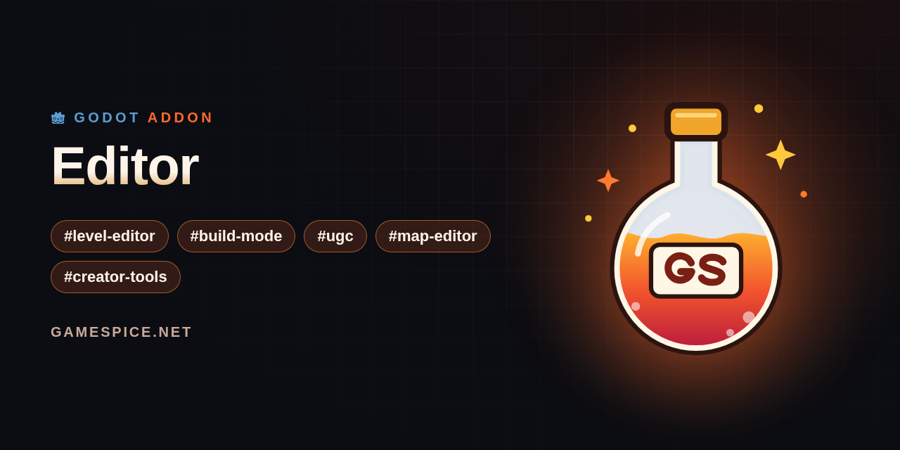

[](https://moddingcommunity.com/a/145-gs-editor)

In-game build mode, for Godot 4.7+. It holds the map a player is building as a document, and every place, move and remove goes through one door that checks who is allowed, which prop, where, how big, and what is left of the budget. Publishing the result is GameSpice Cloud's job. Part of the [GameSpice](https://github.com/gamespice-platform) family. It needs only [GameSpice Core](https://github.com/gamespice-platform/core).

A build mode on a shared server cannot trust the client. The document lives on the server, a client asks to change it, and the server answers with success or a reason. Nothing is clamped silently, and a hand-edited file is held to the same rules as a fresh placement when it loads.

## Install

1. Copy `addons/dot_editor/` and `addons/dot_core/` into your project.
2. Enable GameSpice Editor in *Project > Project Settings > Plugins*.

## Quick start

```gdscript
var doc := DotEditorDocument.new()
doc.config = cfg                                   # a DotEditorConfig
doc.owner = "alice"
doc.editors = PackedStringArray(["bob"])
doc.costs = {"tree": 6.0}                          # a prop not listed costs default_prop_cost
doc.knows = func(prop: String) -> bool: return catalogue.has(prop)

var r := doc.place(actor, "crate", Vector3(4, 0, 2), 90.0, 1.0)
if r.ok:
    var id: int = r.value                          # replicate the item to clients
else:
    reject(r.error.code, r.error.message)          # FORBIDDEN, QUOTA or INVALID, with the reason

doc.move(actor, id, Vector3(5, 0, 2))
doc.remove(actor, id)

var saved := JSON.stringify(doc.to_dict())         # the map document
var back := doc.load_dict(JSON.parse_string(saved))   # checked item by item, untouched on failure
```

## More than place, move and remove

- `set_scale`, `duplicate_item`, `remove_by` (clear a player who left) and `clear`, each behind the same permission check.
- `find_near(pos, radius)` for ids around a point.
- `changed(kind, id)` signal and a `revision` counter, so a client knows its copy is stale.
- `diff_from(older_dict)` returns `{added, removed, changed}` ids, so a server sends only the difference.
- Budgets are kept as running totals: a placement costs the same with ten items or ten thousand.

`examples/editor_demo.gd` walks through them.

## Settings

Every number is a field on `DotEditorConfig`. The values below are defaults, and the ranges are inspector slider limits, not enforced caps. Set the property from code or a config file to go beyond them; 0 means unlimited where it says so.

| Setting | Default | What it does |
| --- | --- | --- |
| `enabled` | true | Turns the editor on or off. Off, every edit is refused. |
| `who_may_edit` | 1 | 0 the owner only, 1 the owner and listed editors, 2 anyone. |
| `allowed_props` | empty | If set, only these prop ids may be placed. |
| `max_items` | 500 | Most items in a document. 0 is unlimited. |
| `max_items_per_actor` | 0 | Most items one editor may place. 0 is unlimited. |
| `max_cost` | 0.0 | Most total cost in a document. 0 is unlimited. |
| `default_prop_cost` | 1.0 | Cost of a prop the cost table does not list. |
| `bounds_m` | 500.0 | Items must sit this many metres or less from the origin on each axis. 0 is unlimited. |
| `grid_snap` | 0.0 | Snap positions to this grid in metres. 0 is off. |
| `min_scale / max_scale` | 0.25 / 4.0 | Scale limits of one item. |
| `max_name_length` | 64 | Longest document title. 0 is unlimited. |

Layers, weakest first: the defaults, `cfg/addon/dot_editor/*.yml`, the game's files, the operator's files, `DOT_EDITOR_*` environment variables, then `--editor-*` flags. A game that wants cvars binds the config with GameSpice Game's `DotGameConfigBinder` (`profile_kind = "editor"`).

## What it is not

**Not the sandbox spawn layer.** GameSpice Props owns the catalogue, per-player spawn limits, undo and the physics gun for sandbox play. This addon is the document a builder is composing, and it asks the catalogue what exists through one Callable.

**Not live admin editing.** GameSpice Workbench edits a running server's settings and profiles. This edits a map.

**Not publishing or storage.** Saving a version, previewing it and publishing it are GameSpice Cloud's. This addon produces the document and refuses bad edits; it does not upload.

**Not the map loader.** Turning a published document into a running map is GameSpice Map's.

## Test

```bash
godot --headless --path . --import
godot --headless --path . res://examples/editor_selftest.tscn
```

The self-test is offline and exits non-zero on any failure (6 sections, 50 checks plus the two summary checks).

## Status

Built and maintained with Claude Code. The test suites pass, but little of this has been in front of real players yet. Please report rough edges by opening an issue.

## Licence

MIT. See [LICENSE](LICENSE). Only the TMC back-end web infrastructure is not open source.
